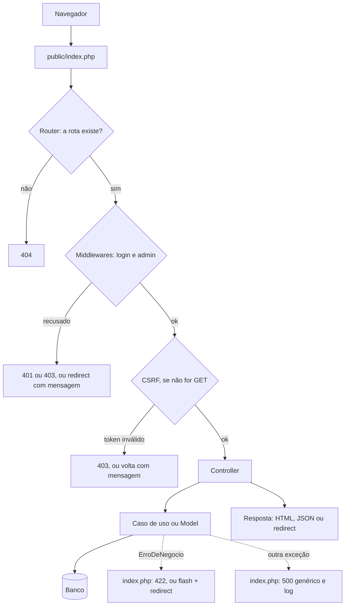
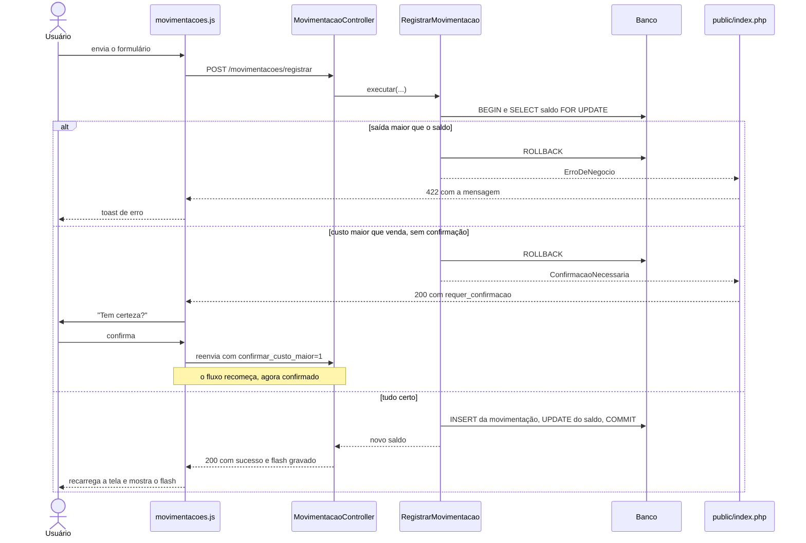

# Arquitetura — Sistema CA Jesus

Este documento descreve a arquitetura e as regras que a sustentam. O que falta fazer está em [`plano.md`](plano.md), e o motivo das decisões, no [diagnóstico](historico/diagnostico-fase-a.md). Quando este documento e o diagnóstico divergirem, vale este.

## Visão geral

O sistema é um **monólito modular em PHP**: uma aplicação, um banco e um único ponto de entrada (`public/index.php`). As telas são templates PHP renderizados no servidor, e algumas ações usam `fetch` com respostas JSON.

O código é organizado por **funcionalidade (Vertical Slice)**, não por tipo técnico. Tudo o que muda junto quando a regra de uma tela muda fica no mesmo slice.

Não fazem parte da arquitetura:
- **framework, microserviços e SPA:** o tamanho do sistema não justifica;
- **CQRS e Mediator:** não há necessidade;
- **interfaces "por via das dúvidas":** só entram quando houver mais de uma implementação real.

## Caminho de uma requisição



## Requisitos

| Item | Versão |
|---|---|
| PHP | ≥ 8.2 (ambiente local: XAMPP com PHP 8.2.12; o PHPUnit 11 exige 8.2, e o PHP 8.1 já não recebe correções de segurança) |
| Banco | MariaDB 10.4+ / MySQL 8+ |
| Composer | 2.x, para o autoload e o PHPUnit |
| Servidor | Apache com `mod_rewrite` |

## Estrutura

```
backend/                              # namespace App\ → backend/ (PSR-4 via Composer)
  config/       config.example.php      # config.php fica fora do git
  storage/logs/                       # logs gerados pela aplicação, fora do git
  database/
    schema.sql                        # estrutura; não cria nem seleciona o banco
    seed.sql                          # dados iniciais de desenvolvimento
  Core/
    Database.php  Router.php  Session.php  Auth.php
    Controller.php                    # render(), json() e redirect()
    RespostaJson.php                  # formato único das respostas JSON
    ErroDeNegocio.php                 # exceção com mensagem que pode ir ao usuário
    ConfirmacaoNecessaria.php         # a operação depende de o usuário confirmar
    DatabaseException.php             # falha de banco já registrada, com mensagem genérica
  Features/
    Autenticacao/   AuthController.php  AuthMiddleware.php  AdminMiddleware.php  AutenticacaoConsultas.php
    Dashboard/      DashboardController.php  DashboardConsultas.php
    Produtos/       ProdutoController.php  ProdutoModel.php
    Movimentacoes/  MovimentacaoController.php  RegistrarMovimentacao.php  MovimentacaoModel.php
    Relatorios/     RelatorioController.php  RelatorioFinanceiro.php  RelatorioEstoque.php  RelatorioConsultas.php
    Usuarios/       UsuarioController.php  PerfilController.php  UsuarioModel.php
    Fornecedores/   FornecedorController.php  FornecedorModel.php
  Shared/
    Formatacao.php
frontend/                             # templates PHP (não públicos)
  views/
    layout.php
    autenticacao/  dashboard/  produtos/  movimentacoes/  relatorios/  usuarios/  fornecedores/
public/                               # única pasta servida pelo Apache
  index.php  .htaccess
  assets/css/  assets/img/
  assets/js/app.js  layout.js  formatacao.js  cep.js  charts.js  <feature>.js
tests/
  bootstrap.php  BancoDeTeste.php
  Core/  Shared/  Features/<Feature>/  # testes PHPUnit (...Test.php)
  e2e/                                # testes no navegador (Playwright + Docker)
docs/
composer.json  phpunit.xml            # vendor/ fica fora do git (composer install)
```

**Por que existem três árvores:** sem uma etapa de build, o navegador só alcança o que está em `public/`. Por isso o JS, o CSS e as imagens ficam em `public/assets/`, enquanto os templates PHP, que não podem ser públicos, ficam em `frontend/views/`. O nome da feature é o mesmo nas três árvores: `Features/Produtos/`, `views/produtos/` e `js/produtos.js`.

`backend/`, `frontend/`, `tests/` e `vendor/` são bloqueados pelo `.htaccess` da raiz, e isso só vale se o Apache ler esse arquivo. Com `DocumentRoot` na raiz do projeto e `AllowOverride None`, esses arquivos ficam acessíveis. Com `DocumentRoot` em `public/`, eles ficam fora da raiz web, que é o modo mais seguro, mas hoje os cabeçalhos de segurança e o `Options -Indexes` estão só no `.htaccess` da raiz e se perdem (achado S-006 da [auditoria](auditoria-seguranca.md)). O servidor só precisa de permissão de escrita em `backend/storage/`, nunca no restante de `backend/`.

## Dentro de um slice

| Peça | Faz | Não faz |
|---|---|---|
| **Controller** | Lê a requisição (`$_POST`, `$_GET`, sessão), chama o caso de uso ou o model, responde com `render()`, `json()` ou `redirect()`. | Regra de negócio, SQL. |
| **Caso de uso** (ex.: `RegistrarMovimentacao`) | Aplica a regra de negócio e controla a transação. Recebe dados simples e devolve um resultado ou lança `ErroDeNegocio`. | Ler `$_POST`/`$_SESSION`, mandar header, redirecionar, gerar HTML. |
| **Model / Consultas** | SQL de uma tabela (model) ou de leitura agregada (consultas). | Regra de negócio, mensagem para o usuário. |

O caso de uso não conhece HTTP. Por isso ele pode ser testado chamando a classe direto, sem simular um formulário.

## Regras

1. **Um arquivo de caso de uso só existe quando há regra de negócio, transação ou cálculo.** Um CRUD simples fica no controller e no model do slice.
2. **Só o slice dono escreve na sua tabela.** Os outros podem ter as próprias queries de leitura.

   | Tabela | Dono | Quem só lê |
   |---|---|---|
   | `tbprodutos` (cadastro) | Produtos | Movimentações, Dashboard, Relatórios |
   | `tbprodutos.estoque_produto` | Movimentações | Produtos, Dashboard, Relatórios |
   | `tbmovimentacoes` | Movimentações | Dashboard, Relatórios |
   | `tbusuarios` | Usuários | Autenticação (também grava `ultimo_login`) |
   | `tbfornecedores` | Fornecedores | Produtos |

3. **`Shared/` só recebe o que pelo menos dois slices usam.** Código usado por um slice só fica nele.
4. **Um slice não chama o controller nem o caso de uso de outro slice.** Se precisar de um dado, faz a própria leitura (regra 2).
5. **Funcionalidade nova tem o mesmo nome nas três árvores:** `backend/Features/<Nome>/`, `frontend/views/<nome>/` e `public/assets/js/<nome>.js`. O JS só existe se a tela precisar (o login não tem). Exceções: `layout.js` é do layout, e `perfil.js` é a segunda tela do slice de Usuários.
6. **A regra de negócio fica em PHP, e o banco serve de rede de segurança.** O banco guarda constraints baratas (`CHECK`, `UNIQUE`, FK) e a auditoria (`tr_auditoria_estoque`). Triggers que decidem regra não entram.
7. **Sem produção, o schema é editado direto em `backend/database/schema.sql`** e o banco local é recriado. As migrações (`database/migrations/NNN_*.sql`) só começam depois do primeiro deploy com dados reais.
8. **Uma branch por mudança**, com um slice por commit. O merge na `main` só acontece depois de os testes passarem e o [roteiro manual](roteiro-de-testes.md) ser validado. O merge é feito com `--no-ff`.

## Contrato das respostas JSON

Toda resposta JSON, de qualquer slice e também do tratamento de erro em `public/index.php`, tem o mesmo formato:

```json
{
  "sucesso": true,
  "mensagem": "Movimentação registrada.",
  "dados": { },
  "requer_confirmacao": false
}
```

| Campo | Tipo | Significado |
|---|---|---|
| `sucesso` | bool | A operação foi concluída. |
| `mensagem` | string \| null | Texto pronto para mostrar ao usuário. Nunca traz detalhe técnico. |
| `dados` | objeto \| lista \| null | Payload da resposta (ex.: o produto buscado, os dados do relatório). |
| `requer_confirmacao` | bool | O backend recusou a operação até o usuário confirmar. O front pergunta e reenvia com o campo de confirmação. |

| Status HTTP | Quando |
|---|---|
| 200 | Sucesso, ou `requer_confirmacao: true` |
| 401 | Sessão expirada ou usuário não logado (o front leva ao login) |
| 403 | Sem permissão ou token CSRF inválido |
| 404 | Recurso ou rota não encontrados |
| 405 | Método não permitido. Ainda não implementado: hoje, método errado responde 404 |
| 409 | Conflito com dados vinculados (ex.: excluir fornecedor que tem produtos) |
| 422 | Regra de negócio ou validação recusou (`ErroDeNegocio`) |
| 500 | Erro inesperado (mensagem genérica, detalhe só no log) |

O controller nunca monta o array à mão: ele usa `$this->json(...)`. Fora de um controller (Router, middlewares, `index.php`), usa-se `RespostaJson::enviar(...)`. Uma `ErroDeNegocio` não capturada vira 422 com a mensagem dela. Qualquer outra exceção vira 500 com a mensagem genérica.

Nos erros tratados fora do controller (`RespostaJson::esperada()`), a resposta é JSON quando o caminho contém `/api/` ou quando a requisição manda `Accept: application/json` ou `X-Requested-With: XMLHttpRequest`. No front, toda chamada usa `requisicaoJson(url, opcoes)` (`public/assets/js/app.js`), que manda esse header, sempre devolve o objeto do contrato (inclusive em falha de rede) e leva ao login quando recebe 401.

**Exemplo: custo maior que venda numa movimentação.** O caso de uso lança `ConfirmacaoNecessaria`. O primeiro envio vem sem `confirmar_custo_maior` e recebe `200 { sucesso: false, requer_confirmacao: true, mensagem: "O preço de custo é maior que o preço de venda. Tem certeza de que deseja registrar?" }`. Se o usuário confirmar, o front reenvia com `confirmar_custo_maior=1`.

O fluxo completo de uma movimentação, incluindo essa confirmação:



As rotas e o que cada uma devolve estão em [`rotas.md`](rotas.md).

## Erros e mensagens

- **`ErroDeNegocio`** é uma mensagem para o usuário ("Saída maior que o estoque disponível"). Ela vira 422 em JSON, ou flash + redirect numa tela.
- **Qualquer outra exceção** vai para o log (`backend/storage/logs/php-erros.log`), e o usuário vê só a mensagem genérica. O detalhe aparece na tela apenas com `ENVIRONMENT = 'development'`.
- Existe **um único mecanismo de mensagem** entre requisições: `Session::flash()`.

## CSRF

Toda requisição que não é GET precisa do token da sessão. O `Router` confere depois dos middlewares, então nenhum controller precisa cuidar disso.

- **Formulário:** inclui `<?= Session::campoCsrf() ?>`.
- **`fetch`:** usa `requisicaoJson()`, que manda o header `X-CSRF-Token` lido da meta tag do layout.
- **Token recusado:** o `fetch` recebe 403 com a mensagem. O formulário volta para a página anterior com a mensagem, já com um token válido.

O token é um por sessão, para funcionar com várias abas, e é trocado no login. O logout ainda é por GET e fica fora dessa proteção (achado S-013 da [auditoria](auditoria-seguranca.md)).

## Autenticação e sessão

O login copia `id`, `tipo`, `nome` e `email` para `$_SESSION`, e os middlewares decidem só com essa cópia, sem consultar o banco. Por isso, hoje, desativar, excluir ou rebaixar um usuário só tem efeito no próximo login, e trocar a senha não encerra outras sessões (achado S-001 da [auditoria](auditoria-seguranca.md)). A sessão expira depois de 2 horas sem requisições, e não há expiração absoluta.

## Testes

- **PHPUnit**, instalado com `composer install`, roda com `vendor/bin/phpunit`.
- **Testa-se primeiro o que mexe com dinheiro e saldo:** `RegistrarMovimentacao` (com banco de teste) e `RelatorioFinanceiro`/`RelatorioEstoque` (cálculos puros).
- O banco de teste se chama `bd_sistema_teste` e é criado a partir de `backend/database/schema.sql`. O `tests/bootstrap.php` define `DB_NAME` antes de carregar a configuração, e `BancoDeTeste` recusa recriar qualquer outro banco.
- CRUDs simples não precisam de teste PHPUnit. Eles são cobertos pelos testes E2E e pelo roteiro manual.
- **E2E (`tests/e2e/`):** Playwright com Chromium, em Apache e PHP no Docker, com o banco em memória. O `rodar.sh` executa em MariaDB 10.4 (igual ao XAMPP) e MySQL 8.0, sem tocar no banco de desenvolvimento. Cobrem o que só aparece no navegador: telas, `fetch`, mensagens, permissões e CSRF.
